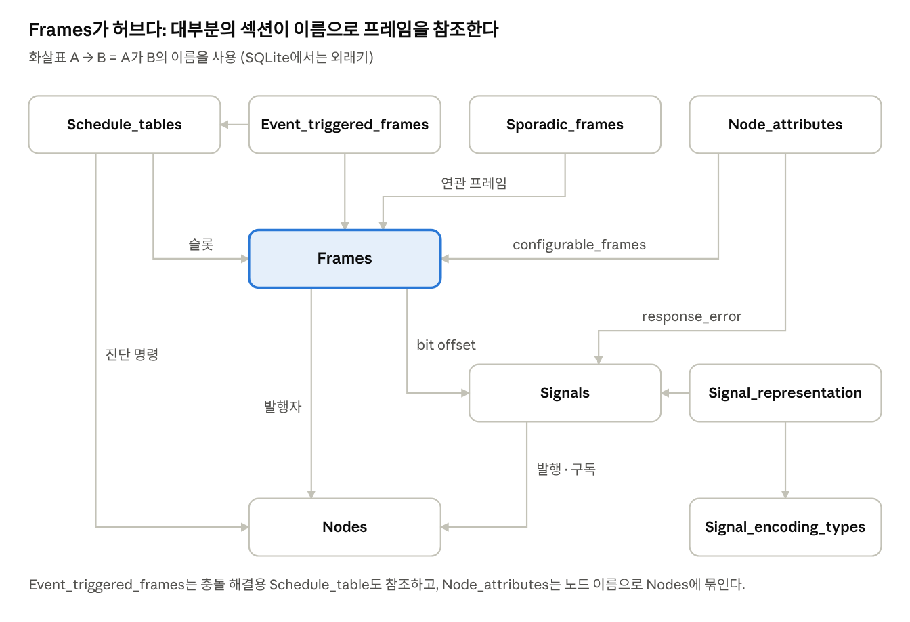
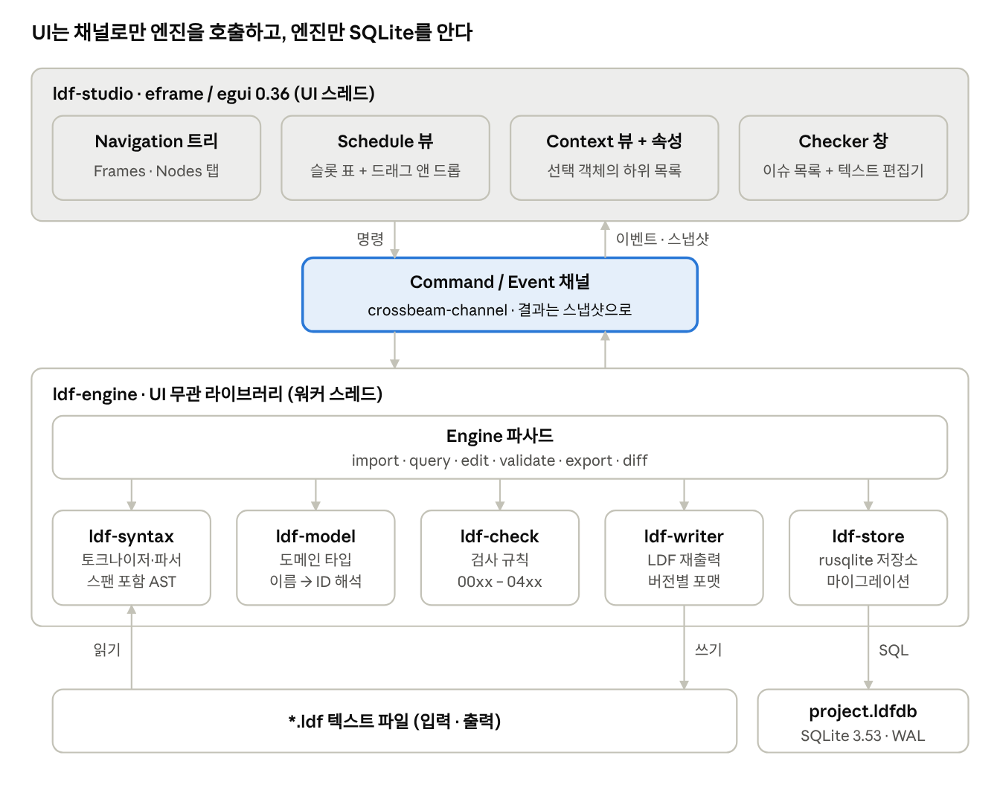
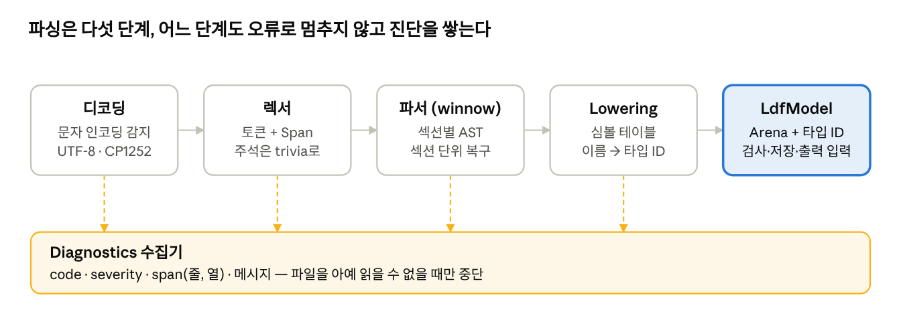
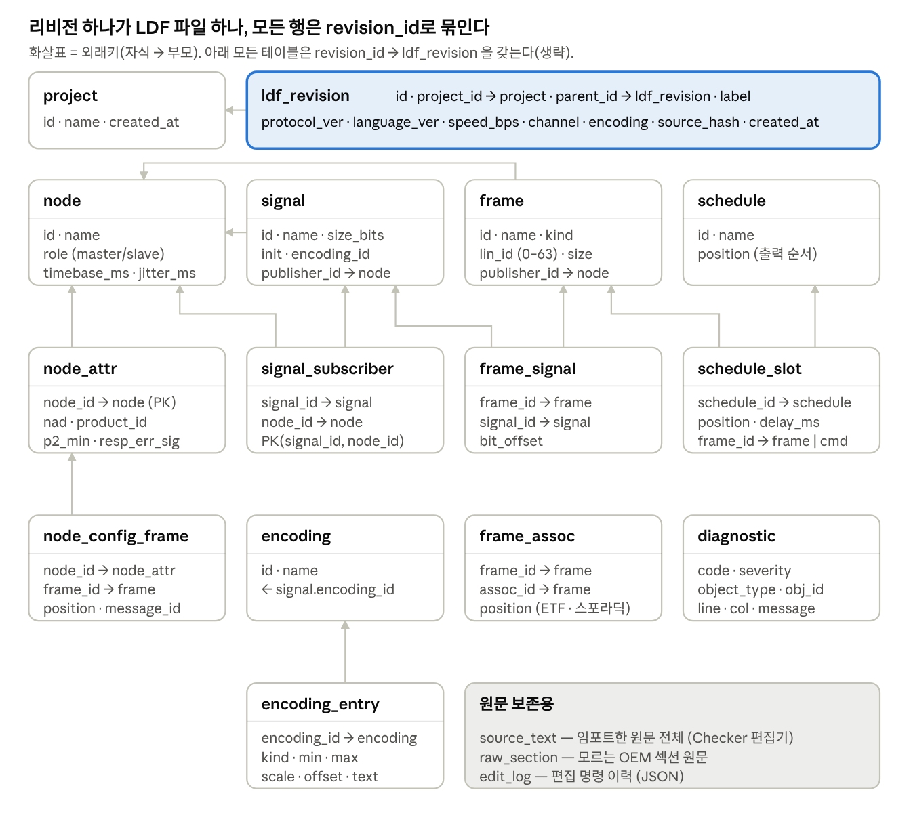
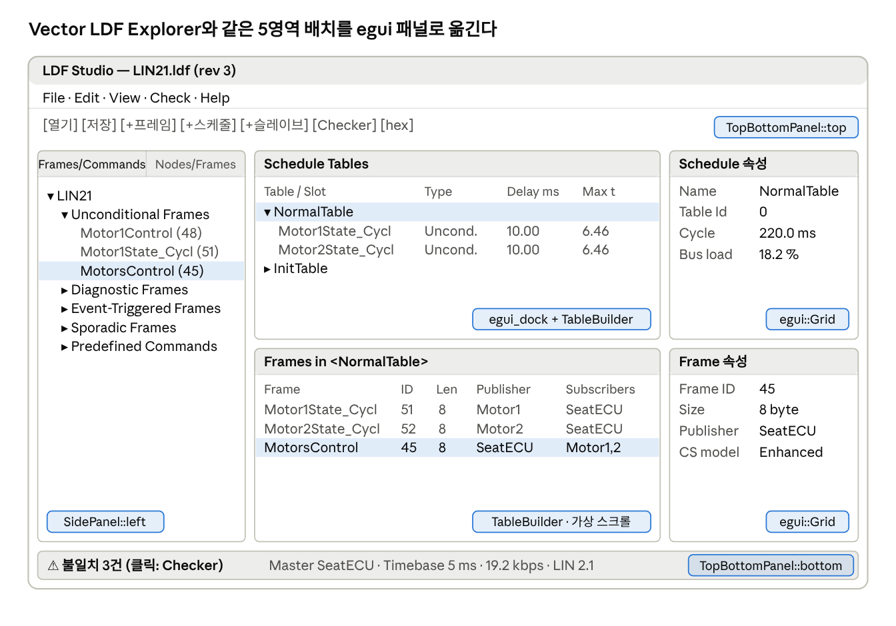
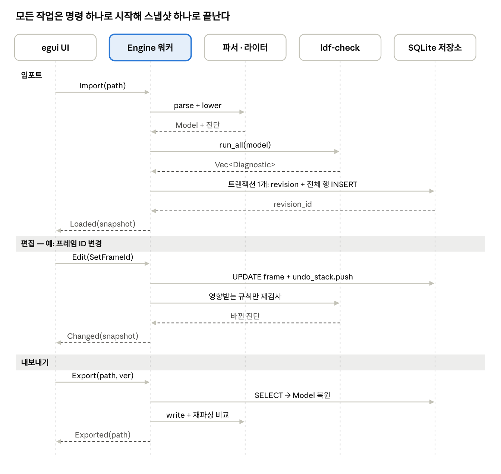
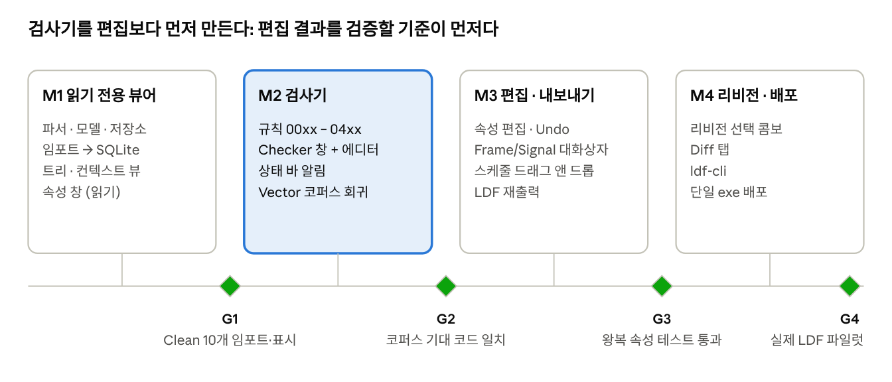

# LDF 엔진 설계서 (Rust · egui · SQLite)

2026-10-18 작성. 이 문서는 claude.ai 문서의 스냅샷이다. 다이어그램은 `docs/img/`의 렌더링 이미지로 넣었다.
요구사항과 충돌하면 [PRD](prd.md)가 우선한다.

## 1. 개요

이 엔진은 LIN 버스의 LDF(LIN Description File)를 읽어 SQLite에 정규화해 저장하고, egui 데스크톱 UI로 조회·편집·검증·재출력하는 Rust 단일 실행 파일이다. 텍스트 파일 한 장으로 흩어져 있던 노드·프레임·시그널 정의를 쿼리 가능한 데이터베이스로 바꾸는 것이 핵심이다.

**용어**

- **LIN**: 차량 내 저속(최대 20 kbit/s) 단일 마스터 시리얼 버스. 표준은 LIN 2.x 및 ISO 17987.
- **LDF**: 한 LIN 클러스터의 노드, 시그널, 프레임, 스케줄 테이블, 인코딩을 기술하는 텍스트 파일.
- **엔진**: 파서 + 도메인 모델 + 저장소 + 검증기 + 내보내기를 묶은 코어 라이브러리. UI는 이 엔진의 소비자다.

**범위**

- 포함: LDF 2.0/2.1/2.2 및 ISO 17987 형식 임포트, 여러 LDF를 하나의 SQLite 프로젝트에 버전별로 보관, 트리/테이블 기반 편집, 규칙 검증, LDF 재출력, 두 버전 비교(diff).
- 제외(1차): 실제 LIN 하드웨어 송수신, 실시간 버스 모니터링. 단, 이후 확장을 위해 디코딩 API는 열어 둔다.

**설계 목표**

1. 왕복 보존: 임포트 → 저장 → 재출력 시 의미가 같은 LDF가 나온다.
2. UI 무관 코어: 엔진 크레이트는 egui에 의존하지 않아 CLI·테스트·다른 UI에서 재사용된다.
3. 응답성: 파싱과 DB I/O는 백그라운드 스레드에서 돌고, UI 프레임은 막히지 않는다.
4. 단일 파일 배포: SQLite를 번들 빌드해 외부 설치 없이 실행된다.

## 2. LDF 파일 포맷 요약

LDF는 `섹션명 { ... }` 블록이 이름으로 서로를 참조하는 텍스트 포맷이다. 따라서 엔진의 본질적 작업은 "이름 참조를 키 참조로 바꾸는 것"이고, 이것이 곧 SQLite 외래키가 된다. 아래 예시는 Vector LDF Explorer의 `TestFiles/Clean/Inconsistency_CLEAN_2_2.ldf`에서 발췌했다.

```
LIN_description_file;
LIN_protocol_version = "2.2";
LIN_language_version = "2.2";
LIN_speed = 19.2 kbps;

Nodes {
  Master: LIN_Master, 1 ms, 0 ms ;
  Slaves: Slave_1, Slave_2 ;
}
Signals {
  Signal_11: 1, 0, LIN_Master, Slave_1 ;   // 이름: 길이, 초기값, 발행자, 구독자...
}
Frames {
  Frame_1: 0, LIN_Master, 2 {              // 이름: ID, 발행자, 바이트 길이
    Signal_11, 0 ;                         // 시그널, 비트 오프셋
  }
}
Schedule_tables {
  Table_1 { Frame_1 delay 10 ms ; }
}
```



이 참조 그래프가 그대로 6장의 외래키가 되고, 참조가 끊기면 검사 코드 00xx(기본 검사) 오류가 된다.

| 섹션 | 내용 | 참조하는 대상 | 필수 여부 |
| --- | --- | --- | --- |
| 헤더 (`LIN_protocol_version`, `LIN_language_version`, `LIN_speed`, `Channel_name`) | 버전, 통신 속도 | - | 필수 (Channel\_name은 2.1+) |
| `Nodes` | Master(타임베이스, 지터)와 Slave 목록 | - | 필수 |
| `Node_composition` | 논리 노드 구성 | Nodes | 선택 |
| `Signals` | 길이(bit), 초기값(스칼라/바이트 배열), 발행/구독 | Nodes | 필수 |
| `Diagnostic_signals` | MasterReq/SlaveResp 바이트 | - | 선택 |
| `Frames` | ID(0–59), 발행자, 크기(1–8 byte), 시그널 배치 | Nodes, Signals | 필수 |
| `Sporadic_frames` | 조건부 전송 프레임 묶음 | Frames | 선택 |
| `Event_triggered_frames` | ID + 연관 프레임, 충돌 해결 스케줄 | Frames, Schedule\_tables | 선택 |
| `Diagnostic_frames` | MasterReq(0x3C), SlaveResp(0x3D) | Diagnostic\_signals | 선택 |
| `Node_attributes` | NAD, product\_id, P2\_min, 응답 오류 신호, configurable\_frames | Nodes, Signals, Frames | 2.x 필수 |
| `Schedule_tables` | 슬롯 순서와 delay, 진단 명령(AssignNAD 등) | Frames, Nodes | 필수 |
| `Signal_groups` | 시그널 묶음 (1.3 호환) | Signals | 선택 |
| `Signal_encoding_types` | 물리값 범위·스케일·오프셋·단위, 논리값 텍스트 테이블 | - | 선택 |
| `Signal_representation` | 인코딩 ↔ 시그널 연결 | Signal\_encoding\_types, Signals | 선택 |

지원 버전 목표는 Vector LDF Explorer와 동일하게 1.3, 2.0, 2.1, 2.2, SAE J2602, ISO 17987:2015로 둔다. 버전마다 허용 섹션·속성이 다르므로(예: 2.0에서 `initial_NAD` 금지) 파서는 관대하게 읽고, 버전별 허용 여부는 검증기가 판단한다.

## 3. Rust 오픈소스 조사

결론: Rust로 성숙한 LDF 파서는 없다. 유일한 후보인 `lin-ldf`는 학습용이고 소스 위치(줄 번호)와 주석을 보존하지 않는다. 검증 결과에 줄 번호를 보여주고 왕복 출력하려면 파서는 `winnow`로 직접 작성하고, `lin-ldf`와 Python `ldfparser`는 교차 검증용 참조 구현으로 쓴다.

### 3.1 LDF / LIN 관련

| 프로젝트 | 언어 / 라이선스 | 현황 | 장점 | 한계 | 우리 엔진에서의 역할 |
| --- | --- | --- | --- | --- | --- |
| [lin-ldf](https://github.com/zpg6/lin-ldf) | Rust / MIT | 0.0.28, ★2 | nom 기반, LIN 2.2A 모든 필수·선택 섹션, serde, WASM 빌드 | 저자 스스로 "프로덕션 부적합" 명시, 주석 무시, 문서화 38% | 파싱 결과 교차 비교(개발 의존성) |
| [ldfparser](https://github.com/c4deszes/ldfparser) | Python / MIT | ★88, pre-release | 1.3–2.2A, 의미 검증, 인코딩/디코딩, LDF→JSON, 주석 캡처 | ISO 17987 미지원, 토큰 위치 미보존, 체크섬 없음 | JSON 스냅샷 오라클(CI에서만 사용) |
| [lin-bus](https://docs.rs/lin-bus) | Rust | 0.x | PID 패리티, classic/enhanced 체크섬 | 드라이버 계층, LDF 미지원 | PID/체크섬 계산 재사용 후보 |
| [dbc-rs](https://lib.rs/crates/dbc-rs) | Rust | 0.7 | DBC 파싱·편집, no\_std | CAN 전용 | 도메인 모델·편집 API 설계 참고 |
| Vector LDF Explorer (로컬 설치본) | 상용 | 1.4.12 | UI 레이아웃, 검사 코드 체계, 테스트 LDF 132개 | 오픈소스 아님 | UI 레퍼런스, 로컬 회귀 테스트 말뭉치(저장소에 커밋 금지) |

### 3.2 UI (egui 생태계)

| 크레이트 | 버전 | 용도 |
| --- | --- | --- |
| [eframe / egui](https://docs.rs/crate/eframe/latest) | 0.36.x 고정 (0.37.0은 2026-10-15 출시) | 앱 프레임, wgpu 기본 렌더러 |
| egui\_extras | egui와 동일 | `TableBuilder`: 가상 스크롤 테이블(시그널 수천 개) |
| [egui\_dock](https://docs.rs/crate/egui_dock/latest) | 0.21.1 (egui 0.36) | 도킹 패널, 탭 분할 |
| [egui\_ltreeview](https://docs.rs/crate/egui_ltreeview/latest) | 0.9.0 (egui 0.36) | 내비게이션 트리, 다중 선택, 드래그 앤 드롭 |
| [egui\_code\_editor](https://docs.rs/crate/egui_code_editor/latest) | 0.4.2 (egui 0.36) | 줄 번호 + 키워드 하이라이트 텍스트 편집기 |
| [rfd](https://docs.rs/crate/rfd/latest) | 0.17.2 | 네이티브 파일 열기/저장 대화상자 |

egui는 0.36으로 고정한다. 0.37이 나온 지 3일밖에 안 됐고 egui\_dock·egui\_ltreeview·egui\_code\_editor가 모두 0.36을 요구하기 때문이다.

### 3.3 저장소·파서·공통

| 크레이트 | 버전 | 선정 근거 | 탈락 후보 |
| --- | --- | --- | --- |
| [rusqlite](https://docs.rs/crate/rusqlite/latest) (`bundled`) | 0.40.2, SQLite 3.53.2 번들 | 동기 API, Windows에서도 외부 SQLite 불필요, MIT | sqlx(비동기 런타임 불필요), diesel/sea-orm(스키마가 작아 ORM 이득 없음) |
| [rusqlite\_migration](https://docs.rs/crate/rusqlite_migration/latest) | 2.6.0 | `user_version` 기반, 별도 테이블 없음 | refinery |
| [winnow](https://docs.rs/crate/winnow/latest) | 1.0.4 | nom 후속, 오류 문맥·위치 추적이 편함, MIT | nom 7(lin-ldf가 사용), pest(문법 파일 분리, 오류 복구 약함) |
| thiserror / anyhow | - | 엔진 오류 타입 / 앱 계층 오류 | - |
| crossbeam-channel | - | UI ↔ 워커 메시지 채널 | tokio(과함) |
| insta | - | 스냅샷 테스트(파싱 결과, 출력 LDF) | - |

버전은 2026-10-18 현재 docs.rs 기준이다.

## 4. 전체 아키텍처

엔진은 Cargo 워크스페이스의 다섯 개 코어 크레이트와 이를 묶는 파사드로 구성되고, egui 앱은 채널을 통해 파사드만 호출한다. 이 경계 덕분에 같은 엔진을 CLI(`ldf-cli check *.ldf`)와 테스트에서 그대로 쓸 수 있다.



파싱과 저장은 워커 스레드에서, 화면 그리기는 UI 스레드에서 일어난다. UI는 SQL을 모르고, 코어 크레이트는 egui를 모른다.

```
ldf_engine_egui/
├─ Cargo.toml              # [workspace]
├─ crates/
│  ├─ ldf-syntax/          # 토크나이저, winnow 파서, 스팬 포함 AST (의미 없음)
│  ├─ ldf-model/           # 도메인 타입, AST → Model 변환(lowering), 이름 해석
│  ├─ ldf-check/           # 검사 규칙 레지스트리, Diagnostic
│  ├─ ldf-writer/          # Model → LDF 텍스트 (버전별 포맷터)
│  ├─ ldf-store/           # rusqlite 저장소, 마이그레이션, 리포지토리
│  └─ ldf-engine/          # 파사드, 명령/이벤트, Undo 스택, diff
├─ apps/
│  ├─ ldf-studio/          # eframe 앱 (egui 패널들)
│  └─ ldf-cli/             # 배치 검사·변환
└─ tests/corpus/           # 공개 가능한 테스트 LDF
```

**의존 규칙**

- `ldf-model`은 다른 내부 크레이트에 의존하지 않는다. 모든 크레이트가 공유하는 어휘다.
- `ldf-syntax`는 문법만 알고, `ldf-model::lower()`가 AST를 모델로 바꾼다.
- `ldf-check`, `ldf-writer`, `ldf-store`는 `ldf-model`에만 의존하며 서로 모른다.
- `ldf-studio`는 `ldf-engine`과 `ldf-model`(표시용 타입)에만 의존한다. `rusqlite`를 직접 가져오면 CI에서 실패하도록 `cargo deny` 규칙을 둔다.

## 5. 파서와 도메인 모델

파서는 틀린 LDF도 끝까지 읽어 "모델 + 진단 목록"을 돌려준다. Vector Consistency Checker처럼 오류를 줄 번호와 함께 보여주고, 오류가 있는 파일도 편집해 고칠 수 있게 하기 위해서다.



### 5.1 단계별 설계 포인트

1. **디코딩**: BOM과 UTF-8 유효성으로 판별하고 실패하면 CP1252로 읽는다. 원본 인코딩은 저장해 두었다가 내보낼 때 그대로 쓴다.
2. **렉서**: 토큰마다 `Span { start, end, line, col }`을 붙인다. `//`·`/* */` 주석은 버리지 않고 다음 토큰의 trivia로 보관해 왕복 출력 때 되살린다.
3. **파서**: 섹션 하나가 깨져도 다음 `식별자 {` 위치까지 건너뛰고 계속한다. 모르는 섹션(OEM 확장)은 `Ast::Unknown`으로 원문 텍스트와 함께 보관한다.
4. **Lowering**: 1차로 모든 이름을 심볼 테이블에 등록하고, 2차로 참조를 ID로 바꾼다. 못 찾은 참조는 `Unresolved(name)`으로 남겨 진단을 내고 모델은 계속 만든다.
5. **모델**: 섹션별 `Vec`(arena)에 담고, 참조는 인덱스 기반 타입 ID로 표현한다. 문자열 참조가 없으므로 이름 변경이 O(1)이다.

### 5.2 핵심 도메인 타입 (`ldf-model`)

```rust
pub struct LdfModel {
    pub header: Header,                 // 버전, 속도, 채널명, 원본 인코딩
    pub nodes: Arena<NodeId, Node>,
    pub signals: Arena<SignalId, Signal>,
    pub frames: Arena<FrameId, Frame>,
    pub encodings: Arena<EncodingId, EncodingType>,
    pub schedules: Arena<ScheduleId, ScheduleTable>,
    pub unknown_sections: Vec<RawSection>, // 왕복 보존용
}

pub struct Signal {
    pub name: String,
    pub size_bits: u16,                 // 1..=64
    pub init: InitValue,                // Scalar(u64) | Array(Vec<u8>)
    pub publisher: Ref<NodeId>,
    pub subscribers: Vec<Ref<NodeId>>,
    pub encoding: Option<Ref<EncodingId>>,
    pub kind: SignalKind,               // Normal | Diagnostic
    pub span: Option<Span>,             // 편집으로 생긴 객체는 None
}

pub enum Frame {
    Unconditional { id: u8, publisher: Ref<NodeId>, size: u8,
                    signals: Vec<(Ref<SignalId>, u8 /* bit offset */)> },
    Sporadic      { associated: Vec<Ref<FrameId>> },
    EventTriggered{ id: u8, collision_table: Option<Ref<ScheduleId>>,
                    associated: Vec<Ref<FrameId>> },
    Diagnostic    { id: u8, signals: Vec<(Ref<SignalId>, u8)> },
}

pub enum Ref<T> { Resolved(T), Unresolved(String) }
```

신호 값 변환(raw ↔ 물리값)과 PID·체크섬 계산도 `ldf-model`에 둔다. UI의 속성 창과 후속 버스 모니터링이 같은 코드를 쓰기 위해서다.

## 6. SQLite 스키마 설계

LDF 파일 하나를 임포트하거나 저장할 때마다 `ldf_revision` 행이 하나 생기고, 모든 엔티티 행은 그 리비전에 속한다. 그래서 한 프로젝트 DB(`*.ldfdb`) 안에서 여러 버전을 보관하고 SQL로 두 버전을 비교할 수 있다.



### 6.1 핵심 DDL (발췌)

```sql
PRAGMA foreign_keys = ON;
PRAGMA journal_mode = WAL;

CREATE TABLE ldf_revision (
  id            INTEGER PRIMARY KEY,
  project_id    INTEGER NOT NULL REFERENCES project(id) ON DELETE CASCADE,
  parent_id     INTEGER REFERENCES ldf_revision(id),
  label         TEXT    NOT NULL,
  protocol_ver  TEXT    NOT NULL,          -- '2.2', 'J2602_1_1.0', 'ISO17987:2015'
  language_ver  TEXT    NOT NULL,
  speed_bps     INTEGER NOT NULL,          -- 19.2 kbps → 19200
  channel       TEXT,
  encoding      TEXT    NOT NULL DEFAULT 'utf-8',
  source_hash   BLOB,                      -- 동일 파일 재임포트 감지
  created_at    TEXT    NOT NULL DEFAULT (datetime('now'))
);

CREATE TABLE signal (
  id           INTEGER PRIMARY KEY,
  revision_id  INTEGER NOT NULL REFERENCES ldf_revision(id) ON DELETE CASCADE,
  name         TEXT    NOT NULL,
  size_bits    INTEGER NOT NULL CHECK (size_bits BETWEEN 1 AND 64),
  init_scalar  INTEGER,                    -- 스칼라 초기값
  init_bytes   BLOB,                       -- 바이트 배열 초기값
  is_diag      INTEGER NOT NULL DEFAULT 0,
  publisher_id INTEGER REFERENCES node(id),
  encoding_id  INTEGER REFERENCES encoding(id) ON DELETE SET NULL,
  src_line     INTEGER,                    -- 진단·에디터 이동용
  UNIQUE (revision_id, name)
);

CREATE TABLE frame_signal (
  frame_id   INTEGER NOT NULL REFERENCES frame(id)  ON DELETE CASCADE,
  signal_id  INTEGER NOT NULL REFERENCES signal(id) ON DELETE CASCADE,
  bit_offset INTEGER NOT NULL CHECK (bit_offset BETWEEN 0 AND 63),
  PRIMARY KEY (frame_id, signal_id)
);

CREATE TABLE schedule_slot (
  id          INTEGER PRIMARY KEY,
  schedule_id INTEGER NOT NULL REFERENCES schedule(id) ON DELETE CASCADE,
  position    INTEGER NOT NULL,
  delay_ms    REAL    NOT NULL,
  frame_id    INTEGER REFERENCES frame(id),
  command     TEXT,                        -- AssignNAD, FreeFormat ...
  command_args TEXT,                       -- JSON
  CHECK ((frame_id IS NULL) <> (command IS NULL))
);
```

### 6.2 설계 결정

| 결정 | 이유 |
| --- | --- |
| 리비전 단위 스냅샷(행 복사) | diff가 `name` 기준 SQL 조인 하나로 끝난다. LDF는 수 KB–수백 KB라 복사 비용이 작다. |
| 참조는 정수 FK, 이름은 `UNIQUE(revision_id, name)` | 이름 변경 시 참조 행을 고칠 필요가 없다. 중복 이름(검사 01열)은 임포트 단계에서 접미사를 붙여 저장하고 진단을 남긴다. |
| 미해석 참조는 별도 `unresolved_ref(table, row_id, column, name)` | FK를 NULL로 두고 원래 이름을 보관해, 깨진 파일도 손실 없이 저장하고 되돌린다. |
| `position` 컬럼 | LDF 출력 순서를 원본과 같게 유지해 diff 노이즈를 없앤다. |
| `diagnostic` 테이블 | 검사 결과 캐시. 프로젝트를 다시 열 때 상태 바 경고를 재검사 없이 바로 표시한다. |
| WAL + 단일 쓰기 연결 | 워커만 쓰고, 읽기 전용 연결은 내보내기·diff에 쓴다. |

### 6.3 마이그레이션

`rusqlite_migration`으로 `PRAGMA user_version`에 스키마 버전을 기록한다. 마이그레이션 SQL은 `crates/ldf-store/migrations/0001_init.sql`처럼 파일로 두고 `include_str!`로 바이너리에 넣는다. 더 높은 버전의 DB를 열면 읽기 전용으로 열고 경고한다.

## 7. egui UI 설계

화면은 로컬에 설치된 Vector LDF Explorer 1.4.12(`C:\Program Files\Vector LDF Explorer`)의 배치를 그대로 따른다. 왼쪽 내비게이션 트리, 가운데 위 스케줄 뷰와 아래 오브젝트 컨텍스트 뷰, 각 뷰 오른쪽의 속성 창, 하단 상태 바다. 검사기(LIN Consistency Checker)는 별도 창이다. Vector 제품의 아이콘·문구·상표는 가져오지 않고 배치와 동작만 참고한다.



### 7.1 영역별 동작과 egui 구현

| 영역 | 동작 (Vector 기준) | egui 구현 |
| --- | --- | --- |
| 툴바 / 메뉴 | 열기·저장, 프레임·스케줄·슬레이브 생성, Checker 열기, 10진/16진 전환 | `TopBottomPanel::top`, `egui::menu`, `rfd` 파일 대화상자 |
| 내비게이션 뷰 | 탭 2개: Frames/Commands(프레임 종류별 + Predefined Commands), Nodes/Frames(노드별 발행·구독 시그널/프레임) | `SidePanel::left` + `egui_ltreeview`, 프레임을 스케줄로 드래그 |
| 스케줄 뷰 | 테이블과 슬롯 트리 표, Delay·최대/최소 프레임 시간, 드래그로 슬롯 추가·순서 변경 | `egui_extras::TableBuilder` + 드롭 타깃 |
| 오브젝트 컨텍스트 뷰 | 선택 객체의 하위 목록(예: 프레임 선택 → 시그널 목록) | `TableBuilder`(가상 스크롤, 열 정렬) |
| 속성 창 ×2 | 위는 스케줄/슬롯, 아래는 나머지 객체 속성. 읽기 전용 값은 회색 | `egui::Grid` + `DragValue`/`ComboBox`/`TextEdit` |
| 상태 바 | 왼쪽 불일치 알림(클릭 시 Checker), Master·Jitter·Timebase·속도·프로토콜 | `TopBottomPanel::bottom` |
| Edit Frame / Edit Signal 대화상자 | 더블클릭으로 열림. 프레임: 이름·ID·발행/구독·시그널 배치. 시그널: 길이·스칼라/바이트배열·인코딩(Physical / Logical / Multi-Range 탭) | `egui::Window`(모달), 비트 레이아웃 미니맵은 `Painter`로 직접 그림 |
| LIN Consistency Checker 창 | 왼쪽 검사 카테고리 트리(Inconsistency / Source / Constraint / Line), 오른쪽 텍스트 편집기, Run Checks·Report | `egui::Window` 또는 `egui_dock` 탭, `egui_code_editor`, 줄 클릭 시 커서 이동 |

Vector 제품에서 후회된 점 두 가지는 다르게 한다. 첫째, 편집은 Pro 없이 기본 제공한다. 둘째, 프로젝트에 여러 리비전이 있으므로 내비게이션 상단에 리비전 선택 콤보와 "Diff" 탭을 둔다.

### 7.2 상태 관리 (즉시 모드에서 주의할 점)

egui는 매 프레임 화면 전체를 다시 그린다. 그래서 프레임 안에서는 SQL을 호출하지 않고, 워커가 보낸 `Arc<ModelSnapshot>`만 읽는다.

```rust
struct AppState {
    snapshot: Arc<ModelSnapshot>,   // 워커가 교체, UI는 읽기만
    selection: Selection,           // Frame(FrameId) | Signal(SignalId) | Slot(..) ...
    nav_tab: NavTab,                // FramesCommands | NodesFrames
    hex: bool,                      // 10진/16진 표시
    pending: Option<JobId>,         // 진행 중 작업 → 스피너
    diagnostics: Arc<Vec<Diagnostic>>,
    dialogs: Dialogs,               // 열린 Edit Frame/Signal 창과 편집 중 초안
    tx: Sender<Command>, rx: Receiver<Event>,
}
```

- 편집은 즉시 상태를 바꾸지 않고 `Command::Edit(EditOp)`을 보낸다. 워커가 DB에 반영하고 새 스냅샷을 돌려주면 화면이 바뀐다.
- 대화상자는 초안(draft) 구조체를 들고 있다가 OK를 누를 때 한 번에 보낸다. 그래서 Undo 한 번으로 대화상자 변경 전체가 취소된다.
- 시그널이 수천 개여도 `TableBuilder::rows()`는 보이는 행만 그리므로 프레임당 비용이 일정하다. 정렬·필터 결과는 스냅샷 버전이 바뀔 때만 다시 계산해 캐시한다.
- 창 크기, 패널 폭, 최근 파일은 eframe `persistence` 기능으로 저장한다. LDF 데이터는 여기에 저장하지 않는다.

## 8. 주요 흐름

UI가 보내는 것은 항상 `Command` 하나, 돌아오는 것은 항상 새 스냅샷을 담은 `Event` 하나다. 그래서 화면은 작업 도중의 반쯤 바뀐 상태를 보지 않는다.



### 8.1 명령 목록

| Command | 처리 | 결과 Event |
| --- | --- | --- |
| `Import(path)` | 디코딩 → 파싱 → 전체 검사 → 트랜잭션 1개로 저장. 같은 `source_hash`가 있으면 새 리비전 대신 기존 것을 연다 | `Loaded` |
| `OpenRevision(id)` | DB에서 모델 복원, 캐시된 진단 로드 | `Loaded` |
| `Edit(EditOp)` | 트랜잭션 안에서 적용, 역연산을 undo 스택에 쌓음, 영향 규칙만 재검사 | `Changed` |
| `Undo` / `Redo` | 저장된 역연산 적용 | `Changed` |
| `RunChecks` | 전체 규칙 실행, `diagnostic` 테이블 갱신 | `Checked` |
| `ApplyText(text)` | Checker 창 텍스트 편집 결과를 재파싱해 새 리비전으로 저장 | `Loaded` |
| `Export(path, version)` | DB → 모델 → 텍스트. 출력을 다시 파싱해 모델이 같은지 확인한 뒤 임시 파일을 원자적으로 rename | `Exported` |
| `Diff(a, b)` | 이름 기준 SQL 조인으로 추가·삭제·변경 목록 산출 | `DiffReady` |

### 8.2 Undo 설계

각 `EditOp`은 `apply(&mut Tx) -> InverseOp`를 구현한다. 대화상자의 OK 한 번은 `EditOp::Batch(Vec<EditOp>)` 하나로 묶여 Undo 한 번에 취소된다. Undo 스택은 메모리에 두고, 저장 시점에 `edit_log` 테이블에 JSON으로 남겨 감사 이력으로 쓴다.

## 9. 검사 규칙, 스레딩, 오류 처리, 테스트

### 9.1 검사 규칙 체계

검사 코드는 Vector Consistency Checker의 다섯 카테고리와 같은 자리수를 쓴다. 그래야 로컬 테스트 LDF의 "Failed Checks" 기대값과 바로 비교할 수 있다. 아래 예시는 `TestFiles`의 파일 설명에서 추린 것이며, 코드와 의미의 대응은 구현 중에 확인해야 하는 추정이다.

| 코드 대역 | 카테고리 | 예시 (테스트 파일 설명 기준) | 기본 심각도 |
| --- | --- | --- | --- |
| 00xx | Basic | 잘못된 protocol/language 버전(0010), 슬레이브 LIN 버전 불일치(0030), 정의되지 않은 시그널 참조, 중복 이름 | Error |
| 01xx | LDF Format | 해당 버전에 없는 섹션·속성(2.0의 `initial_NAD`, ISO 속성이 2.2 파일에), 버전별 스케줄 명령 형식 | Error |
| 02xx | Modelling | 스케줄되지 않은 프레임, 슬롯 없는 스케줄, 프레임 ID 중복, NAD 중복, 인코딩 min > max, 한 시그널에 인코딩 여러 개 | Warning |
| 03xx | Parameter | LIN\_speed 범위, NAD·Supplier/Function/Variant ID 범위, 프레임 크기 1–8 byte, 시그널 길이·초기값 범위, P2\_min | Error |
| 04xx | Mapping | 프레임에 배치되지 않은 시그널, 시그널 겹침·프레임 초과, 바이트 경계를 넘는 시그널, 사용하지 않는 바이트, 발행자 불일치 | Info–Error |

규칙은 `trait Rule { fn code(&self) -> u16; fn deps(&self) -> Deps; fn check(&self, m: &LdfModel, out: &mut Vec<Diagnostic>); }`로 구현하고 레지스트리에 등록한다. `deps`는 규칙이 읽는 테이블 집합이며, 편집 후에는 바뀐 테이블을 읽는 규칙만 다시 돌린다. 심각도는 프로젝트 설정에서 코드별로 조정할 수 있다.

### 9.2 스레딩

- **UI 스레드**: eframe 이벤트 루프. 프레임마다 `rx.try_recv()`로 이벤트를 비우고 스냅샷을 교체한다. 블로킹 호출은 없다.
- **워커 스레드 1개**: `rusqlite::Connection`을 소유하고 명령을 순서대로 처리한다. 쓰기가 한 곳에서만 일어나므로 락이 필요 없다. 이벤트를 보낸 뒤 `egui::Context::request_repaint()`를 호출해 UI를 깨운다.
- **긴 작업**: 대형 임포트·전체 검사는 `Event::Progress(pct)`를 보내고, `Arc<AtomicBool>` 취소 플래그를 검사한다. 취소 시 트랜잭션을 롤백한다.
- **읽기 전용 연결**: Diff·내보내기는 WAL 덕분에 별도 읽기 연결로 돌려 편집을 막지 않는다.

### 9.3 오류 처리

| 종류 | 예 | 처리 |
| --- | --- | --- |
| 진단(Diagnostic) | 미정의 참조, 범위 초과 | 오류가 아니라 데이터다. 저장하고 Checker와 상태 바에 표시 |
| `EngineError::Io` / `Decode` | 파일 없음, 인코딩 판별 실패 | `Event::Failed`, 토스트 알림, 상태 변화 없음 |
| `EngineError::Db` | 디스크 부족, 잠금 | 트랜잭션 롤백 후 보고, 마지막 스냅샷 유지 |
| `EngineError::Schema` | 더 높은 스키마 버전 DB | 읽기 전용으로 열기 |
| 워커 패닉 | 버그 | `catch_unwind` → `Event::Fatal`, UI가 워커 재시작을 제안 |

### 9.4 테스트 전략

1. **단위 테스트**: 섹션별 파서, PID 패리티·체크섬, 신호 raw↔물리값 변환.
2. **스냅샷 테스트**: `insta`로 코퍼스 LDF의 모델 JSON과 재출력 텍스트를 고정한다.
3. **왕복 속성 테스트**: `proptest`로 임의 모델을 만들어 write → parse 결과가 원래 모델과 같은지 확인한다. DB 저장 → 복원도 같은 방식으로 검사한다.
4. **Vector 테스트 말뭉치 회귀**: 로컬 `TestFiles`의 LDF 132개(Basic 15, Clean 10, Format 28, Mapping 23, Modelling 29, Parameter 27)를 돌린다. 각 파일 머리의 `Failed Checks:` 줄을 읽고, `HowTo.txt` 규칙대로 `solely`는 정확히 일치, `ignore`는 제외, 그 외는 "최소 포함"으로 비교한다. 경로는 `LDF_VECTOR_TESTFILES` 환경 변수로 받고, 파일은 저장소에 커밋하지 않는다(상용 제품 동봉물).
5. **교차 검증**: 선택적 CI 작업에서 Python `ldfparser`의 JSON 출력과 필드별로 비교한다.
6. **DB 테스트**: 이전 스키마 버전마다 마이그레이션을 실행하고 `PRAGMA foreign_key_check`가 비어 있는지 확인한다.
7. **UI 테스트**: 패널을 스냅샷만 받는 순수 함수로 두고, egui 저장소의 `egui_kittest`로 주요 화면을 렌더링해 비교한다.

## 10. 구현 로드맵과 리스크

읽기 전용 뷰어 → 검사기 → 편집 → 리비전 순서로 만든다. 각 단계는 게이트 조건을 통과해야 다음으로 넘어간다. 일정은 인력이 정해지면 채운다.



| 리스크 | 영향 | 대응 |
| --- | --- | --- |
| LIN 스펙 모호성, OEM별 변형 문법 | 실제 파일 파싱 실패 | 관대한 파서 + 모르는 섹션은 `raw_section`으로 보관, OEM 변형 파일(`CLEAN_OEMvariant.ldf`)을 코퍼스에 포함 |
| 검사 코드 의미를 테스트 파일 설명에서 추정 | Vector와 다른 판정 | 코퍼스 회귀로 하나씩 확인, 불일치는 규칙별로 문서화 |
| egui 생태계 버전 지연 (egui 0.37 출시, 보조 크레이트는 0.36) | 업그레이드 충돌 | 0.36 고정, 업그레이드는 M4에서 일괄 진행 |
| 왕복 시 주석·서식 손실 | 사용자가 diff에서 불필요한 변경을 봄 | trivia 보관 + `position` 열. 합격 기준은 바이트 동일이 아니라 의미 동일 |
| 비 UTF-8 파일 | 한글·독일어 주석 깨짐 | 인코딩 판별 후 원본 인코딩으로 다시 저장 |
| 같은 `.ldfdb`를 두 인스턴스가 열기 | 쓰기 충돌 | 시작 시 잠금 파일, 두 번째는 읽기 전용 |
| 상용 자산 혼입 | 라이선스 위반 | Vector 아이콘·문구·테스트 파일은 저장소에 넣지 않음. lin-ldf·ldfparser는 MIT |

## 출처

- [lin-ldf (GitHub)](https://github.com/zpg6/lin-ldf), [lin-ldf (docs.rs)](https://docs.rs/lin-ldf)
- [ldfparser (GitHub)](https://github.com/c4deszes/ldfparser)
- [lin-bus (docs.rs)](https://docs.rs/lin-bus)
- [eframe](https://docs.rs/crate/eframe/latest), [egui\_dock](https://docs.rs/crate/egui_dock/latest), [egui\_ltreeview](https://docs.rs/crate/egui_ltreeview/latest), [egui\_code\_editor](https://docs.rs/crate/egui_code_editor/latest), [rfd](https://docs.rs/crate/rfd/latest)
- [rusqlite](https://docs.rs/crate/rusqlite/latest), [rusqlite\_migration](https://docs.rs/crate/rusqlite_migration/latest), [winnow](https://docs.rs/crate/winnow/latest)
- Vector LDF Explorer 1.4.12 로컬 설치본: `Exec32\Help01\LDFExplorer.chm`(Screen Layout, Navigation View, Schedule Area, Object Context Area, Edit Frame/Signal Dialog, LIN Consistency Checker), `Exec32\TestFiles\` 및 `HowTo.txt`

## 부록. 구현 중 설계에서 달라진 점

구현하면서 확인된 사실에 맞춰 달라진 부분이다. 요구사항과 충돌하면 [PRD](prd.md)가 우선한다.

| 설계서 | 구현 | 이유 |
| --- | --- | --- |
| `ldf-model`은 다른 내부 크레이트에 의존하지 않는다 | `ldf-model`이 `ldf-syntax`에 의존한다 | lowering이 구문 트리를 읽는다. `ldf-syntax`는 내부 크레이트에 의존하지 않고, `ldf-check`·`ldf-writer`·`ldf-store`는 `ldf-model`에만 의존한다. |
| 파서 전체를 `winnow`로 작성 | 렉서만 `winnow`(`LocatingSlice`), 구조 파서는 재귀 하강 | LDF 문법이 문장·블록으로 균일해 구조 파서가 섹션 의미를 몰라도 되고, 오류 복구(누락된 `}`, 중첩 한도)가 단순해진다. |
| 테이블 PK는 전역 `id INTEGER` | `(revision_id, idx)` 복합 키, `idx`는 모델 arena 인덱스 | 저장 → 복원이 손실 없이 같은 모델을 만들고, 참조 무결성은 복합 외래키가 보장한다. |
| 시그널 길이 등에 `CHECK` 범위 | 범위 `CHECK` 없음 | 깨진 LDF도 손실 없이 저장해야 한다. 범위는 검사 규칙(03xx)이 잡는다. |
| 해석되지 않은 참조는 `unresolved_ref` 표 | 참조 컬럼 쌍 `*_idx` / `*_name` | 이름만 보관하는 쪽이 단순하고 손실이 없다. |
| 프레임 ID `u8`, 신호 길이 `u16` | `u32` | 범위를 벗어난 값도 모델에 담아 규칙이 진단하게 한다. |
| 이벤트는 `Loaded`/`Changed` | `Loaded`(임포트·열기), `Edited`(편집·Undo·Redo·재검사), `Saved`, `Diffed`, `RevisionDeleted`, `Exported`/`ExportBlocked`, `RuleSettings` | 열린 리비전이 그대로인 갱신(`Edited`)은 선택·트리 같은 화면 상태를 유지해야 해서 `Loaded`와 나눴다. |
| `EditOp::apply(&mut Tx) -> InverseOp`, 역연산 스택 | 이름으로 대상을 가리키는 `EditOp::apply(&mut LdfModel)`(전부 적용하거나 전혀 적용하지 않음). Undo/Redo는 편집 전후의 **텍스트**를 쌓는다 | 편집한 모델을 텍스트로 써 다시 읽으므로 스냅샷의 위치·진단이 항상 맞고, 되돌리면 그 텍스트를 다시 읽은 것과 같아 모든 연산에서 대칭이 증명 없이 보장된다. 100단계 이상, 총 128MB 상한. |
| 삭제는 ID로 | 삭제는 이름으로, 참조를 정리하고 뒤 ID를 당긴다(`Arena::remove`) | 대화상자가 방금 만든 객체를 같은 `Batch` 안에서 이름으로 이어 쓸 수 있다. |
| 새 객체는 arena 끝에 | 새 프레임·시그널은 다시 읽었을 때와 같은 위치(자기 종류 섹션의 끝)에 끼운다(`Arena::insert`) | 속성 시험이 편집한 모델과 왕복한 모델의 ID 순서 불일치를 찾아냈다. 같은 순서면 ID가 안정적이다. |
| 편집 뒤 영향받는 규칙만 재검사(증분) | 편집마다 전체를 다시 검사 | 시그널 500개 LDF에서 3.5 ms(릴리스)라 200 ms 기준을 크게 밑돈다. 결과는 항상 전체 검사와 같다. |
| 규칙은 `Rule` 트레이트가 코드를 내고 설정은 UI가 | `RuleSettings`(끄기·심각도)를 프로젝트 DB(`rule_setting`)에 저장하고 엔진이 적용 | 같은 `.ldfdb`를 다른 PC에서 열어도 유지된다. 리비전을 열 때 규칙 결과는 저장된 진단이 아니라 지금 설정으로 다시 낸다. |
| 내보내기는 항상 모델에서 다시 씀 | 편집하지 않았으면 원문을 그대로 쓴다. 편집했으면 모델에서 다시 쓴 텍스트에 원문의 주석을 옮긴다(`ldf-writer::carry_comments`): 원문·새 텍스트의 문장마다 이름표(섹션/첫 토큰/몇 번째)를 붙이고 주석을 뒤따르는 문장 앞·같은 줄 문장 뒤·블록 끝에 걸어 같은 이름표 옆에 놓는다. 파일 머리말 주석은 `Header::leading_comment` | 주석은 모델에 넣지 않고도 보존된다. Vector TestFiles 132개가 바이트 동일, 주석 1,094개 모두 유지. |
| 의존성 라이선스는 MIT/Apache/BSD/Zlib/Unicode | egui 기본 글꼴 크레이트(`epaint_default_fonts`)에 한해 OFL-1.1, Ubuntu-font-1.0 허용 | 글꼴 파일에만 해당하는 허용형 라이선스. `deny.toml`에 예외로 명시. |
