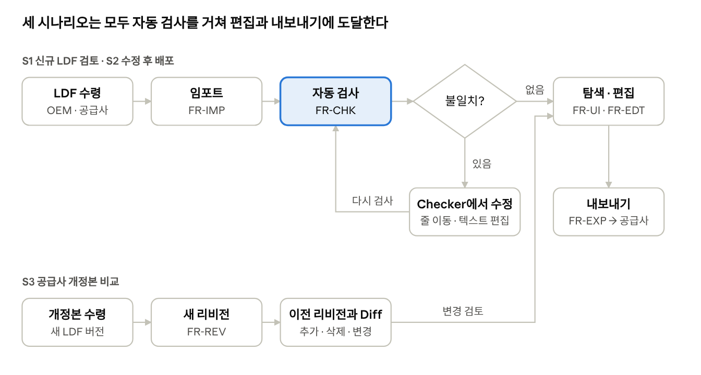
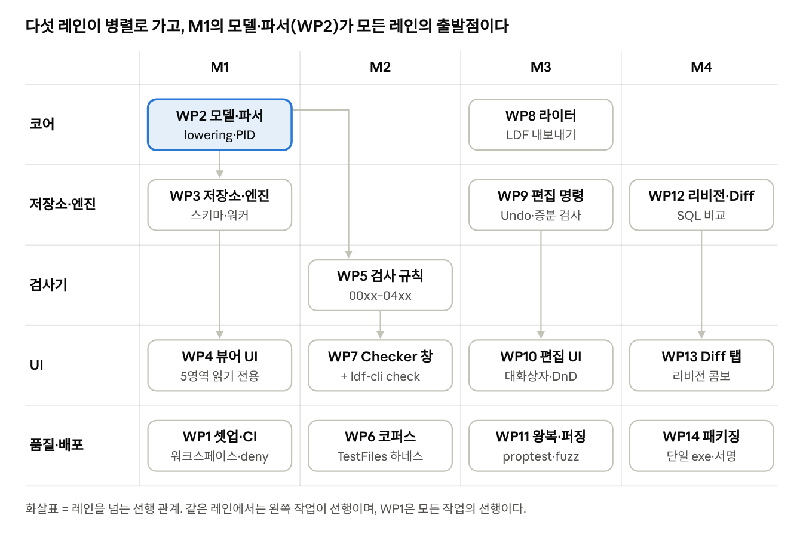

# LDF Studio 개발지시서 (PRD)

2026-10-18 작성. 이 문서는 claude.ai 문서의 스냅샷이다. 다이어그램은 `docs/img/`의 렌더링 이미지로 넣었다.

## 1. 개요

**LDF Studio**는 LIN Description File(LDF)을 열어 보고, 검사하고, 고치고, 버전별로 보관하는 Windows 데스크톱 도구다. Rust로 만들고, UI는 egui, 저장소는 SQLite를 쓴다.

**배경**

- 현재 LDF 편집은 텍스트 에디터나 상용 도구(Vector LDF Explorer, 편집은 Pro 라이선스)에 의존한다.
- 파일 단위로만 관리되어 "어느 버전에서 무엇이 바뀌었는가"를 알기 어렵다.
- Rust 생태계에는 실무에 쓸 만한 LDF 파서가 없다. 유일한 후보인 `lin-ldf`는 작성자가 학습용이라고 밝혔다.

**참조 문서**

- 설계서: [design.md](design.md) — 아키텍처, SQLite 스키마, 파서 파이프라인, UI 와이어프레임. 이 PRD와 설계서가 충돌하면 **PRD가 우선**한다.
- UI 레퍼런스: 로컬 설치본 Vector LDF Explorer 1.4.12 (`C:\Program Files\Vector LDF Explorer`). 배치와 동작만 참고하고 아이콘·문구는 가져오지 않는다.

**용어**: 요구사항 ID는 `FR-<영역>-<번호>`(기능), `NFR-<번호>`(비기능)로 쓴다. 우선순위 P0는 해당 마일스톤 출시 필수, P1은 같은 마일스톤 목표, P2는 여유가 있을 때 한다.

## 2. 목표와 성공 지표

목표는 세 가지다. 상용 도구 없이 LDF를 편집하고, 편집 결과를 자동으로 검사하고, 모든 변경을 리비전으로 추적한다. 아래 목표치는 제안값이며 M1 착수 전에 확정한다.

| 지표 | 측정 방법 | 목표 (제안) |
| --- | --- | --- |
| 임포트 성공률 | Vector `TestFiles/Clean` 10개 + 사내 실제 LDF를 열었을 때 치명 오류 없이 모델이 만들어지는 비율 | 100% |
| 검사 일치율 | Vector `TestFiles` 132개의 `Failed Checks` 기대값과 비교(`HowTo.txt` 규칙) | M2 종료 시 95% 이상, 불일치는 전부 사유 기록 |
| 왕복 보존 | 임포트 → 내보내기 → 재임포트한 모델이 원본 모델과 의미상 같은 비율 | 100% (Clean 코퍼스 + 속성 테스트 10,000회) |
| 응답성 | 500개 시그널 LDF에서 선택 → 화면 갱신 시간 | 1프레임(16 ms) 이내 |
| 임포트 시간 | 100 KB LDF 임포트 + 전체 검사 | 1초 이내 |
| 파일럿 만족도 | M4 파일럿 사용자가 "텍스트 에디터 대신 쓰겠다"고 답한 비율 | 오픈 이슈 참고 |

## 3. 사용자와 핵심 시나리오

| 사용자 | 하는 일 | LDF Studio에서 필요한 것 |
| --- | --- | --- |
| LIN 네트워크 설계자 | 클러스터의 프레임·스케줄 정의, LDF 배포 | 편집, 검사, 리비전 관리 |
| ECU 소프트웨어 개발자 | 받은 LDF로 통신 코드 작성 | 빠른 탐색, 시그널 비트 배치 확인, 버전 간 차이 |
| 시험 엔지니어 | 트레이스 해석, 시험 케이스 작성 | 신호 인코딩, 스케줄 타이밍 |

- **S1 신규 LDF 검토**: 받은 파일을 열면 자동 검사가 돌고, 상태 바에 불일치 건수가 나온다. 클릭하면 Checker에서 해당 줄로 이동한다.
- **S2 수정 후 배포**: 프레임을 추가하거나 ID를 바꾼다. 검사 오류가 0건이면 내보내고 공급사에 전달한다.
- **S3 개정본 비교**: 공급사가 보낸 개정본을 새 리비전으로 넣고 이전 리비전과 비교해 변경점을 검토한다.

## 4. 범위

1차 출시(M1–M4)는 "파일을 다루는 도구"까지다. 버스에 붙는 기능은 없다.

| 포함 | 제외 (이유) |
| --- | --- |
| LDF 1.3, 2.0, 2.1, 2.2, SAE J2602, ISO 17987:2015 읽기·쓰기 | LIN 하드웨어 송수신, 버스 모니터링 (드라이버·라이선스 범위 밖) |
| SQLite 프로젝트 파일(`.ldfdb`)에 여러 리비전 보관 | 서버·다중 사용자 동시 편집 (단일 사용자 데스크톱) |
| Vector LDF Explorer와 같은 5영역 화면 + Checker 창 | DBC·ARXML·FIBEX 변환 (별도 제품 검토) |
| 검사 규칙 00xx–04xx, 심각도 설정 | 터미널 텍스트 편집기 수준의 고급 편집 기능 (자동완성 등) |
| 속성 편집, Edit Frame/Signal 대화상자, 스케줄 드래그 앤 드롭, Undo/Redo | macOS·Linux 정식 지원 (빌드는 가능하게 유지, 검증은 Windows만) |
| 리비전 Diff, 배치 검사 CLI(`ldf-cli`) | 다국어 UI (1차는 한국어·영어 문자열만, 키는 분리해 둠) |

## 5. 기능 요구사항 — 임포트·저장 (FR-IMP)

어떤 LDF든 크래시 없이 열려야 하고, 열린 내용은 하나의 트랜잭션으로 SQLite에 저장되어야 한다.

| ID | 요구사항 | 인수 기준 | 우선순위 | 마일스톤 |
| --- | --- | --- | --- | --- |
| FR-IMP-01 | 파일 대화상자 또는 드래그 앤 드롭으로 `.ldf`를 연다 | `TestFiles/Clean` 10개가 모두 열리고, 1초를 넘기면 진행률이 표시된다 | P0 | M1 |
| FR-IMP-02 | 헤더의 protocol/language 버전을 인식한다 (1.3, 2.0, 2.1, 2.2, J2602, ISO 17987) | Clean 파일별 버전이 상태 바에 정확히 표시된다 | P0 | M1 |
| FR-IMP-03 | 문자 인코딩을 판별한다 (UTF-8, BOM, CP1252 폴백). 원본 인코딩을 기록한다 | CP1252 독일어 주석이 깨지지 않고, 내보내기 시 같은 인코딩으로 저장된다 | P1 | M1 |
| FR-IMP-04 | 문법 오류가 있어도 섹션 단위로 복구해 끝까지 읽고, 오류는 진단으로 남긴다. 모르는 섹션은 원문으로 보관한다 | `TestFiles` 132개 전부 패닉 없이 모델이 만들어진다. 각 진단에 줄·열이 있다 | P0 | M1 |
| FR-IMP-05 | 프로젝트 파일(`.ldfdb`)을 만들고 연다. 임포트 한 번 = 리비전 하나, 단일 트랜잭션 | 임포트 도중 프로세스를 강제 종료해도 `PRAGMA integrity_check`와 `foreign_key_check`가 통과한다 | P0 | M1 |
| FR-IMP-06 | 내용 해시가 같은 파일을 다시 임포트하면 기존 리비전을 연다 | 같은 파일 재임포트 시 리비전 수가 늘지 않는다(사용자가 새로 만들기를 고르지 않는 한) | P2 | M1 |
| FR-IMP-07 | 원문 전체와 주석(trivia)을 저장한다 | DB에서 원문을 바이트 단위로 복원할 수 있다. 주석 유지는 FR-EXP-03에서 검증 | P1 | M1 |
| FR-IMP-08 | 최근 연 파일 10개를 메뉴에 보여준다 | 재시작 후에도 목록이 유지된다(eframe persistence) | P2 | M1 |

## 6. 기능 요구사항 — 탐색 화면 (FR-UI)

화면 배치와 동작은 Vector LDF Explorer 1.4.12를 따른다. 와이어프레임은 설계서 7장에 있다. M1에서는 모든 화면이 읽기 전용이다.

| ID | 요구사항 | 인수 기준 | 우선순위 | 마일스톤 |
| --- | --- | --- | --- | --- |
| FR-UI-01 | 메인 창 5영역: 내비게이션, 스케줄 뷰, 컨텍스트 뷰, 속성 창 2개, 상태 바 | 패널 크기를 조절할 수 있고 재시작 후 유지된다. 1280×720에서 잘리는 영역이 없다 | P0 | M1 |
| FR-UI-02 | 내비게이션 Frames/Commands 탭: Unconditional, Diagnostic, Event-Triggered, Sporadic, Predefined Commands 그룹. 항목은 `이름 (ID)` | `CLEAN_2_2.ldf`의 프레임 6개, ETF 1개, 스포라딕 1개, 진단 2개가 해당 그룹에 나온다 | P0 | M1 |
| FR-UI-03 | 내비게이션 Nodes/Frames 탭: 노드별 Published/Subscribed Signals·Frames | 노드 하나를 펼치면 네 하위 그룹과 항목 수가 LDF와 일치한다 | P0 | M1 |
| FR-UI-04 | 스케줄 뷰: 테이블·슬롯 트리 표(Type, Delay, Max/Min frame time). 테이블 속성에 Bus load, Total cycle | 19.2 kbps에서 8바이트 프레임의 Min = 6.46 ms, Max = 9.04 ms + 마스터 지터 (Nominal = (34 + 10×(N+1)) × T\_bit, Max = 1.4 × Nominal) | P0 | M1 |
| FR-UI-05 | 컨텍스트 뷰: 선택 객체의 하위 목록(테이블 → 프레임, 프레임 → 시그널, 노드 → 프레임). 열 정렬 | 5,000행 목록을 스크롤해도 프레임이 16 ms를 넘지 않는다 | P0 | M1 |
| FR-UI-06 | 속성 창: 위는 스케줄·슬롯, 아래는 나머지 객체. 계산값·읽기 전용 값은 회색 | 프레임 선택 시 CS model(Classic/Enhanced), ID, 크기, 발행자, 구독자가 나온다 | P0 | M1 |
| FR-UI-07 | 숫자 10진/16진 표시 전환 (툴바 `hex`) | 전환 시 ID, NAD, 초기값이 모두 바뀐다 | P1 | M1 |
| FR-UI-08 | 프레임 비트 레이아웃 미니맵 (8바이트 × 8비트, 시그널별 색, 겹침은 경고색) — Vector에 없는 추가 기능 | `Inconsistency_0086.ldf`(시그널 겹침)에서 겹친 비트가 강조된다 | P1 | M1 |
| FR-UI-09 | 이름 검색 (Ctrl+F): 프레임·시그널·노드 필터 | 입력 즉시 트리가 걸러지고 Enter로 첫 결과가 선택된다 | P1 | M2 |
| FR-UI-10 | 상태 바: Master, Jitter, Timebase, Channel, LIN Speed, LIN Protocol | Clean 파일 10개의 값이 헤더와 일치한다 | P0 | M1 |
| FR-UI-11 | 다크/라이트 테마, 한국어/영어 전환 | 설정에서 바꾸면 재시작 없이 적용된다 | P2 | M4 |

## 7. 기능 요구사항 — 검사기 (FR-CHK)

검사기는 편집보다 먼저 완성한다(M2). 편집 기능의 인수 기준이 "검사 오류가 생기지 않는다"이기 때문이다. 검사 코드 체계는 Vector Consistency Checker의 다섯 카테고리(Basic, LDF Format, Modelling, Parameter, Mapping)와 같은 자리수를 쓴다.

| ID | 요구사항 | 인수 기준 | 우선순위 | 마일스톤 |
| --- | --- | --- | --- | --- |
| FR-CHK-01 | 임포트 직후 전체 검사를 자동으로 실행한다 | 파일을 열면 별도 조작 없이 상태 바에 결과가 나온다 | P0 | M2 |
| FR-CHK-02 | 규칙 00xx–04xx를 구현한다. 규칙마다 코드, 제목, 기본 심각도, 제약 설명을 갖는다 | `TestFiles` 132개 기대 코드 일치율 95% 이상. 불일치는 `docs/check-deviations.md`에 파일별 사유 기록 | P0 | M2 |
| FR-CHK-03 | Checker 창 왼쪽: 카테고리 → 규칙 `[코드]` → 개별 결과 트리. 열은 Inconsistency, Source, Constraint, Line. 문제 없는 카테고리는 `(OK)` | `Inconsistency_0050.ldf`에서 Modelling 아래 `[0202]` 결과 2건이 줄 번호와 함께 나온다 | P0 | M2 |
| FR-CHK-04 | Checker 창 오른쪽: 줄 번호·키워드 강조 텍스트 편집기. 결과를 더블클릭하면 해당 줄로 이동 | 이동 후 커서가 진단의 줄·열에 있고 그 줄이 화면 안에 보인다 | P0 | M2 |
| FR-CHK-05 | 텍스트를 고친 뒤 Run Checks로 재파싱·재검사, 적용하면 새 리비전으로 저장 | 오류를 고치고 적용하면 메인 창과 상태 바가 즉시 갱신된다 | P1 | M2 |
| FR-CHK-06 | 심각도 3단계(Info, Warning, Error). 규칙별 심각도 변경·끄기를 프로젝트에 저장 | 규칙을 끄면 다음 검사부터 나오지 않고, 다른 PC에서 같은 `.ldfdb`를 열어도 유지된다 | P1 | M2 |
| FR-CHK-07 | 상태 바 왼쪽에 불일치 건수 표시, 클릭하면 Checker 창 열기 | Error가 있으면 경고 아이콘과 건수, 없으면 "문제 없음" | P0 | M2 |
| FR-CHK-08 | 텍스트 편집기 Undo/Redo, 찾기·바꾸기, 줄 이동(Ctrl+G) | 단축키가 동작한다 | P1 | M2 |
| FR-CHK-09 | 편집 후에는 영향받는 규칙만 재검사(증분 검사) | 500 시그널 LDF에서 프레임 ID 변경 후 결과 갱신 200 ms 이내, 전체 검사 결과와 동일 | P1 | M3 |
| FR-CHK-10 | 검사 보고서를 HTML·CSV로 저장 (Create Report) | CSV가 Excel에서 깨지지 않고 열린다(UTF-8 BOM) | P2 | M2 |

## 8. 기능 요구사항 — 편집·Undo·내보내기 (FR-EDT, FR-EXP)

모든 편집은 명령(`Command::Edit`)으로 워커에 보내고, 편집 후에는 영향 규칙을 재검사한다. 내보낸 파일을 다시 읽으면 같은 모델이 나와야 한다.

| ID | 요구사항 | 인수 기준 | 우선순위 | 마일스톤 |
| --- | --- | --- | --- | --- |
| FR-EDT-01 | 속성 창에서 값을 바로 편집한다. 범위 밖 값은 입력 중에 표시한다 | 프레임 ID에 64를 넣으면 필드가 빨간색이 되고 적용되지 않는다 | P0 | M3 |
| FR-EDT-02 | Edit Frame 대화상자(더블클릭): 이름, ID, 발행·구독 노드, 시그널 추가·제거·시작 비트, 시그널 생성·삭제. 진단 프레임은 열리지 않는다 | 비트 미니맵에서 겹침이 즉시 보이고, OK 후 04xx 검사 결과가 갱신된다 | P0 | M3 |
| FR-EDT-03 | Edit Signal 대화상자: 이름, 길이, 스칼라/바이트 배열, 초기값, 발행·구독, 인코딩(Physical / Logical / Multi-Range 탭) | 시그널당 인코딩 0–1개. Logical 테이블의 행을 [X]로 삭제할 수 있다 | P0 | M3 |
| FR-EDT-04 | 툴바로 생성: Unconditional·Event-Triggered·Sporadic 프레임, 스케줄 테이블, 슬레이브 노드 | 생성 직후 고유한 기본 이름과 빈 ID가 제안되고, 내비게이션에서 선택된 상태가 된다 | P0 | M3 |
| FR-EDT-05 | 스케줄: 내비게이션의 프레임·명령을 끌어다 슬롯 추가, 끌어서 순서 변경, delay 편집 | delay가 Timebase의 배수가 아니거나 프레임 최대 시간보다 짧으면 경고가 뜬다 | P2 | M3 |
| FR-EDT-06 | 삭제 시 참조하는 곳(프레임, 스케줄, configurable\_frames 등)을 보여주고 확인 후 함께 제거한다 | 삭제 후 미정의 참조(00xx) 진단이 생기지 않는다 | P0 | M3 |
| FR-EDT-07 | 이름 변경은 모든 참조에 자동 반영된다 | 시그널 이름을 바꾼 뒤 내보내면 Frames, Signal\_representation, Node\_attributes 어디에도 옛 이름이 없다 | P1 | M3 |
| FR-EDT-08 | Undo/Redo(Ctrl+Z / Ctrl+Y). 대화상자 OK 한 번은 1단계, 최소 100단계 | 대화상자에서 5개 필드를 바꾼 뒤 Undo 한 번에 전부 되돌아간다 | P0 | M3 |
| FR-EDT-09 | 저장 안 된 변경을 제목에 `*`로 표시하고, 종료·다른 파일 열기 전에 확인한다 | 변경 후 창을 닫으면 저장/버리기/취소를 묻는다 | P1 | M3 |
| FR-EXP-01 | LDF로 내보낸다. 기본은 원본 버전 형식, 다른 버전을 고르면 표현 불가 항목을 먼저 경고한다 | 2.2 파일을 2.0으로 내보내면 Channel\_name 등 제거 항목 목록이 나온다 | P0 | M3 |
| FR-EXP-02 | 왕복 보존: 내보낸 파일을 다시 임포트하면 모델이 의미상 같다 | Clean 10개 + 속성 테스트 10,000회 전부 통과 | P0 | M3 |
| FR-EXP-03 | 주석, 섹션·항목 순서, 모르는 섹션을 유지한다 | 편집하지 않은 파일을 내보내면 원본과의 텍스트 diff가 공백 차이뿐이다 | P1 | M3 |
| FR-EXP-04 | Error가 남아 있으면 내보내기 전에 확인을 받는다 | 확인 창에 Error 건수와 "Checker 열기" 버튼이 있다 | P1 | M3 |
| FR-EXP-05 | 임시 파일에 쓴 뒤 rename하는 원자적 쓰기. 원본 인코딩과 줄바꿈(CRLF/LF) 유지 | 쓰기 도중 종료해도 기존 파일이 손상되지 않는다 | P0 | M3 |
| FR-EXP-06 | 모델을 JSON으로 내보낸다(다른 도구 연동용) | JSON 스키마를 `docs/model.schema.json`으로 공개하고 검증을 통과한다 | P2 | M3 |

## 9. 기능 요구사항 — 리비전·Diff·CLI (FR-REV, FR-CLI)

한 프로젝트 파일 안에 LDF의 모든 버전이 남고, 두 버전의 차이를 객체 단위로 볼 수 있어야 한다. 검사 CLI는 CI에서 쓰기 위해 M2에 먼저 낸다.

| ID | 요구사항 | 인수 기준 | 우선순위 | 마일스톤 |
| --- | --- | --- | --- | --- |
| FR-REV-01 | 내비게이션 상단의 리비전 콤보: 라벨, 생성 시각, 출처 파일명 | 리비전을 바꾸면 모든 뷰가 해당 리비전으로 바뀐다(선택은 같은 이름 객체가 있으면 유지) | P0 | M4 |
| FR-REV-02 | 저장 = 새 리비전 생성(부모 리비전 연결). 라벨 입력 | 저장 후 부모–자식 관계가 리비전 목록에 트리로 보인다 | P0 | M4 |
| FR-REV-03 | Diff 탭: 두 리비전의 추가·삭제·변경 객체와 필드별 이전/이후 값. 프레임은 이름이 바뀌어도 LIN ID가 같으면 "이름 변경"으로 표시 | Clean 2.1 → 2.2 비교 결과를 수작업 비교표와 대조해 누락이 없다 | P0 | M4 |
| FR-REV-04 | Diff 결과를 CSV·HTML로 저장 | 공급사에 그대로 보낼 수 있는 표 형식이다 | P1 | M4 |
| FR-REV-05 | 리비전 삭제(자식이 있으면 경고) | 삭제 후 `foreign_key_check` 통과, DB 크기 `VACUUM`으로 회수 | P2 | M4 |
| FR-CLI-01 | `ldf-cli check <files...> [--format text\|json]`. 종료 코드 0 = 문제 없음, 1 = Warning, 2 = Error, 3 = 실행 실패 | 같은 파일에 대해 GUI Checker와 같은 진단 목록을 낸다 | P0 | M2 |
| FR-CLI-02 | `ldf-cli convert <in> --to <ver> -o <out>` | FR-EXP-01과 같은 경고를 stderr로 출력한다 | P1 | M4 |
| FR-CLI-03 | `ldf-cli diff <a.ldf> <b.ldf>` | FR-REV-03과 같은 결과를 텍스트·JSON으로 낸다 | P1 | M4 |
| FR-CLI-04 | `ldf-cli import\|export` 로 `.ldfdb` 조작 | 스크립트로 리비전을 쌓고 꺼낼 수 있다 | P2 | M4 |

## 10. 비기능 요구사항 (NFR)

모든 NFR은 모든 마일스톤에 적용되며, 검증 방법이 CI에 자동화되어 있어야 한다.

| ID | 항목 | 요구 | 검증 방법 |
| --- | --- | --- | --- |
| NFR-01 | 성능 | 콜드 스타트 2초 이내. 100 KB LDF 임포트+전체 검사 1초 이내. UI 프레임 16 ms 이내. 1 MB LDF에서 메모리 300 MB 이하 | `criterion` 벤치마크, 합성 대형 LDF 생성기 |
| NFR-02 | 안정성 | 어떤 입력에도 파서가 패닉하지 않는다. 워커 패닉 시 UI는 살아남고 재시작을 제안한다. DB는 강제 종료에도 손상되지 않는다 | `cargo-fuzz` 1시간 크래시 0, 강제 종료 테스트 |
| NFR-03 | 배포 | Windows 10/11 x64 단일 실행 파일, 설치 불필요, SQLite 번들 | 깨끗한 Windows VM에서 실행 스모크 테스트 |
| NFR-04 | 의존성 고정 | egui/eframe 0.36, rusqlite 0.40(`bundled`), Rust stable. `Cargo.lock` 커밋, `rust-toolchain.toml`로 툴체인 고정 | CI에서 `cargo build --locked` |
| NFR-05 | 데이터 보호 | LDF는 고객 기밀이다. 네트워크 접속·텔레메트리 없음. 로그에 시그널·프레임 이름 등 내용을 남기지 않는다 | 로그 출력 검사 테스트, 의존성에 네트워크 크레이트 없음(`cargo deny`) |
| NFR-06 | 라이선스 | 의존성은 MIT, Apache-2.0, BSD, Zlib, Unicode만. Vector 아이콘·문구·테스트 파일을 저장소에 넣지 않는다 | `cargo deny check licenses`, `.gitignore`와 pre-commit 훅 |
| NFR-07 | 사용성 | 키보드만으로 주요 작업 가능. DPI 배율 100–200%에서 글자가 잘리지 않는다 | `egui_kittest` 렌더 스냅샷(100%, 150%, 200%) |
| NFR-08 | 로그 | `tracing`으로 `%LOCALAPPDATA%\LDFStudio\logs`에 기록, 7일 보관 | 통합 테스트 |
| NFR-09 | 코드 품질 | `clippy -D warnings`, `rustfmt`, 엔진 크레이트 라인 커버리지 80% 이상, `unsafe` 금지(예외는 리뷰 승인) | CI 게이트, `cargo-llvm-cov` |

## 11. 개발 지시

작업은 14개 패키지(WP)로 나누고, 한 WP는 한 명이 한 크레이트 범위 안에서 끝낼 수 있는 크기로 잡았다. 서로 다른 레인의 WP는 같은 파일을 고치지 않으므로 병렬로 진행한다.

### 11.1 작업 패키지별 지시

| WP | 대상 | 지시 | 완료 시 산출물 |
| --- | --- | --- | --- |
| WP1 셋업·CI | 루트, `.github/` | 설계서 4장의 워크스페이스 구조 생성. CI에 fmt, clippy, test, `cargo deny`, `build --locked` | 빈 크레이트 8개가 CI 통과 |
| WP2 모델·파서 | `ldf-model`, `ldf-syntax` | `winnow`로 렉서·파서(Span·trivia 보존, 섹션 단위 복구), 도메인 타입, `lower()`, PID·체크섬. egui·rusqlite 의존 금지 | Clean 10개 모델 스냅샷(`insta`) |
| WP3 저장소·엔진 | `ldf-store`, `ldf-engine` | 설계서 6장 스키마를 `migrations/0001_init.sql`로. 모델↔DB 매퍼, 워커 스레드, `Command`/`Event` 채널 | 저장 → 복원 모델이 원본과 같다는 테스트 |
| WP4 뷰어 UI | `apps/ldf-studio` | FR-UI-01–10. 패널은 `fn show(ui, &Snapshot, &mut Selection)` 형태의 순수 함수 | 로컬 Vector 화면과 나란히 둔 스크린샷 비교 |
| WP5 검사 규칙 | `ldf-check` | `Rule` 트레이트 + 레지스트리. 규칙 하나 = 파일 하나(`rules/r0406_frame_mapping.rs`) | 규칙별 단위 테스트 |
| WP6 코퍼스 | `tests/vector_corpus.rs` | `LDF_VECTOR_TESTFILES` 경로의 파일을 읽고 `Failed Checks` 줄을 `HowTo.txt` 규칙(solely/ignore/normal)대로 비교. 변수가 없으면 skip | 일치율 리포트(파일별 기대/실제) |
| WP7 Checker 창 | `apps/ldf-studio`, `apps/ldf-cli` | FR-CHK-03–08, FR-CLI-01. 텍스트 편집기는 `egui_code_editor` | 동일 입력에서 GUI·CLI 진단이 같다는 테스트 |
| WP8 라이터 | `ldf-writer` | 버전별 포맷터, trivia 복원, 원자적 쓰기 | FR-EXP-01–05 테스트 |
| WP9 편집 명령 | `ldf-engine` | `EditOp::apply(&mut Tx) -> InverseOp`, `Batch`, 규칙 `deps` 기반 증분 검사 | 모든 EditOp에 대해 apply→inverse 후 모델 동일 테스트 |
| WP10 편집 UI | `apps/ldf-studio` | FR-EDT-01–09. 대화상자는 초안 구조체를 들고 OK 시 `Batch` 하나를 보냄 | `egui_kittest` 시나리오 테스트 |
| WP11 왕복·퍼징 | `tests/`, `fuzz/` | `proptest` 모델 생성기, `cargo-fuzz` 파서 타깃 | 10,000회 왕복 통과, 퍼징 1시간 크래시 0 |
| WP12 리비전·Diff | `ldf-store`, `ldf-engine` | FR-REV-01–05 엔진 부분, 이름 기준 SQL 조인 diff | Diff 결과 스냅샷 |
| WP13 Diff 탭 | `apps/ldf-studio`, `apps/ldf-cli` | 리비전 콤보, Diff 탭, `ldf-cli diff` | 화면 스냅샷 |
| WP14 패키징 | `.github/`, `apps/` | 릴리스 빌드, 아이콘·버전 리소스, 서명(오픈 이슈 참고) | 깨끗한 VM에서 실행 |

### 11.2 코딩 규칙

1. **경계 준수**: UI는 SQL을 모른다. `apps/ldf-studio`가 `rusqlite`를 직접 가져오면 CI가 실패하도록 `cargo deny`에 규칙을 둔다.
2. **패닉 금지**: 라이브러리 크레이트에서 `unwrap()`/`expect()` 금지(테스트 제외). 오류는 `thiserror` 타입, 앱에서만 `anyhow`.
3. **진단은 데이터**: LDF 내용의 문제는 `Result::Err`가 아니라 `Diagnostic`으로 돌려준다.
4. **UI 프레임 예산**: `update()` 안에서 I/O, 잠금, 1 ms를 넘는 계산을 하지 않는다.
5. **스키마 변경**: 기존 마이그레이션 파일은 수정하지 않고 새 파일만 추가한다.
6. **기밀 데이터**: 실제 고객 LDF와 Vector `TestFiles`는 커밋 금지. 테스트용 파일은 익명화해 `tests/corpus/`에 둔다.
7. **PR 단위**: PR 하나 = WP 하나의 일부, 400줄 이내 권장. 제목에 요구사항 ID를 넣는다(예: `[FR-CHK-03] Checker 트리 열 추가`).

## 12. 마일스톤과 인수 기준

마일스톤은 게이트를 통과해야 끝난다. 게이트 판정은 아래 데모 시나리오를 팀 앞에서 실행하고, P0 요구사항의 인수 기준을 자동 테스트로 확인하는 것이다. 일정은 인력 배정 후 채운다.

| 마일스톤 | WP | 포함 요구사항 | 게이트 (인수 기준) | 데모 시나리오 |
| --- | --- | --- | --- | --- |
| M1 읽기 전용 뷰어 | WP1–4 | FR-IMP-01–08, FR-UI-01–10 | G1: Clean 10개 임포트·표시, 프레임 시간 계산 일치(FR-UI-04), 크래시 0 | `CLEAN_2_2.ldf`를 끌어다 놓고 트리·스케줄·속성을 Vector 화면과 나란히 비교 |
| M2 검사기 | WP5–7 | FR-CHK-01–08, FR-CHK-10, FR-CLI-01 | G2: 코퍼스 일치율 95% 이상, 불일치 전부 사유 기록 | `Inconsistency_0050.ldf`를 열고 상태 바 → Checker → 줄 이동 → 수정 → Run Checks로 0건 |
| M3 편집·내보내기 | WP8–11 | FR-EDT-01–09, FR-EXP-01–06, FR-CHK-09 | G3: 왕복 10,000회 통과, 퍼징 1시간 크래시 0, Undo 모든 EditOp 대칭 | 프레임 추가 → 시그널 배치 → 스케줄에 드래그 → Undo/Redo → 내보내기 → Vector LDF Explorer로 열어 불일치 0건 |
| M4 리비전·배포 | WP12–14 | FR-REV-01–05, FR-CLI-02–04, FR-UI-11 | G4: 파일럿 사용자가 실제 LDF로 S1–S3를 수행, 치명 이슈 0건 | 두 리비전 Diff → CSV 저장, 깨끗한 VM에서 단일 exe 실행 |

### 12.1 완료 정의 (Definition of Done)

요구사항 하나는 아래를 모두 만족해야 "완료"다.

- [ ] 인수 기준을 검증하는 자동 테스트가 있고 CI에서 통과한다 (UI는 `egui_kittest` 또는 수동 시험 기록)
- [ ] `clippy -D warnings`, `rustfmt`, `cargo deny` 통과
- [ ] 공개 API에 문서 주석, 사용자에게 보이는 변경은 `CHANGELOG.md`에 기록
- [ ] 스키마를 바꾼 경우 새 마이그레이션 + 이전 버전 DB 업그레이드 테스트
- [ ] NFR-01 성능 벤치마크가 회귀하지 않았다 (기준 대비 +10% 이내)
- [ ] 코드 리뷰 승인 1명 이상, PR 제목에 요구사항 ID

## 13. 오픈 이슈

M1 착수 전에 결정이 필요한 항목이다.

- [ ] 성공 지표(2장)의 제안 목표치 확정, 파일럿 만족도 목표와 파일럿 대상자 선정
- [ ] 인력·일정: 레인별 담당자와 마일스톤 날짜
- [ ] 검사 코드 의미: 00xx–04xx의 규칙별 의미는 Vector 테스트 파일 설명에서 추정한 것이다. Vector 공식 문서(라이선스 보유 시)로 확인할지, 코퍼스 결과만으로 판단할지
- [ ] Vector `TestFiles` 사용 범위: 사내 CI 서버에 복사해 쓸 수 있는지 라이선스 확인 (기본안: 개발자 PC에서만 실행)
- [ ] 코드 서명 인증서: 사내 인증서 사용 여부 (없으면 SmartScreen 경고)
- [ ] 라이선스·배포 형태: 사내 전용인지, 오픈소스 공개인지 (공개 시 제품명 상표 검토)
- [ ] J2602 전용 규칙 범위: J2602 Clean 파일 3개 외에 실제 파일이 있는지
- [ ] 프로젝트 파일 확장자 `.ldfdb` 확정 및 Windows 파일 연결 여부
